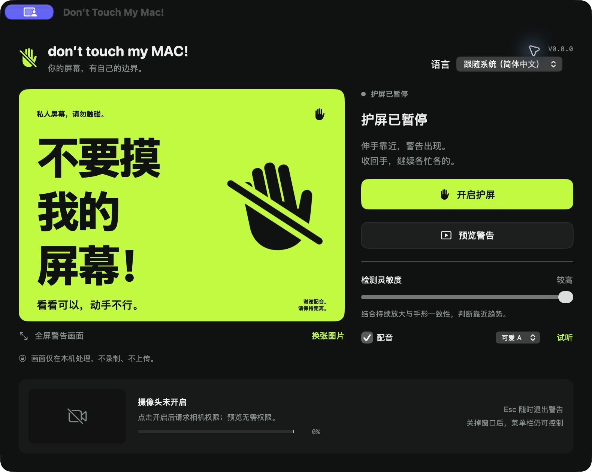

# Don’t Touch My Mac!

<p align="center">
  
  
  
  
  
</p>

一个轻量原生 macOS 屏幕防触碰护屏小工具：通过前置摄像头实时监测手部靠近屏幕的动态趋势，在他人手指触碰屏幕前瞬间弹出醒目的全屏警告与萌系语音提示；收手后自动平滑恢复。

告别同事、朋友“指点江山”在你的 Retina 屏幕或外接显示器上留下油腻指纹的烦恼！

---

## 📥 下载安装（推荐普通用户）

不需要懂代码，直接下载已打包好的安装镜像即可使用：

> 👉 **[点击下载最新版 DontTouchMyMac.dmg](https://github.com/DDTer/dont-touch-my-mac/releases/latest/download/DontTouchMyMac.dmg)**  
> *(或在 [GitHub Releases 页面](https://github.com/DDTer/dont-touch-my-mac/releases) 查看所有历史版本)*

### 快速安装步骤

1. 下载 `DontTouchMyMac.dmg` 并双击打开；
2. 将 `Don't Touch My Mac` 图标拖拽到 `Applications`（应用程序）文件夹中；
3. 打开应用并授权摄像头权限（**画面仅在本地内存用于手势几何估算，绝不录制、绝不联网上传**）；
4. 点击 **“开启护屏”**，或随时按下全局快捷键 **`⌥⌘G`** 即可进入保护状态。

> [!TIP]
> **首次打开提示“无法打开，因为无法验证开发者”？**  
> 因为本项目为个人开源项目，未购买苹果昂贵的商业开发者公证证书：  
> 请在访达的“应用程序”中找到它，**按住 Control 键或右键点击图标 -> 选择「打开」**；或前往 Mac「系统设置」->「隐私与安全性」，滚动到底部点击**「仍要打开」**即可。

---

## 📸 界面效果预览

| 控制面板（中文界面） | 全屏警告画面（多屏同步覆盖） |
| :---: | :---: |
|  |  |

*(同时也支持 [英文界面](docs/screenshots/en.jpg) 与 [日文界面](docs/screenshots/ja.jpg))*

---

## ✨ 核心特性

- ⚡️ **动态靠近趋势判定**：采用单目视觉骨骼拓扑尺度与多帧几何回归算法，灵敏识别伸手靠近，打字操作与横向挥手不误报。
- 🖥 **多显示器全屏覆盖**：外接多台显示器时，触发警告会同步覆盖所有活动屏幕，全方位防触碰。
- ⌨️ **全局快捷键 `⌥⌘G`**：随时在任何应用、看视频或离开工位前快速开启/暂停护屏，无需切回窗口。
- 🎙 **离线萌系配音**：内置中/英/日三种语言的可爱风语音提示（每种语言提供 A/B/C 三种声线），纯离线播放，无需网络 API。
- 🖼 **自定义警告画面**：支持选择本地喜爱的图片替换默认警告海报。
- 🛡 **收手自愈 & 紧急暂停**：手收回后约 0.4 秒自动恢复原窗口；警告期间随时按 `Esc` 可紧急暂停。
- 🔋 **省心后台驻留**：关闭主面板后自动保留菜单栏图标；电脑睡眠或锁屏时自动暂停，唤醒后平滑恢复。

---

## 🔒 隐私声明

- **零网络访问**：应用不申请、不使用任何网络连接权限，没有任何分析追踪或遥测代码。
- **纯本地内存计算**：摄像头输入流仅在本地通过 Apple 原生 Vision 框架提取关键点坐标，计算完成后立即丢弃，**绝不在本地硬盘录像、截图或向任何服务器上传**。
- **安心离线音频**：所有配音均为内置已压缩 WAV 文件，不需要任何第三方云端 TTS 密钥。

---

## 🛠 本地开发与编译（面向开发者）

项目原生开发，最低支持 macOS 14.0，基于纯 Swift 5，不含任何外部三方依赖。

### 1. 源码编译与自测

```sh
# 克隆仓库
git clone https://github.com/DDTer/dont-touch-my-mac.git
cd dont-touch-my-mac

# 重新生成工程并运行完整自测（包含 50+ 项检测状态机回归与三语词条检查）
./Scripts/build.sh
```

构建输出：`build/Build/Products/Release/Don't Touch My Mac.app`。  
工程使用 `project.yml` 作为 XcodeGen 源文件，仓库中亦提交了生成的 `DontTouchMyMac.xcodeproj`，可直接用 Xcode 打开调试。

### 2. 本地生成发布用 DMG 安装包

```sh
./Scripts/package_dmg.sh
```
执行后将在 `build/DontTouchMyMac.dmg` 自动生成带 `/Applications` 软链接的标准安装镜像。

---

## 📂 工程结构

- `Sources/App/`：应用生命周期与系统通知委托（`AppDelegate`、Carbon 全局快捷键调度）。
- `Sources/Models/`：业务核心状态机（`GuardModel`、多屏窗口调度、离线配音驱动）。
- `Sources/Views/`：控制面板（`MainScreen`）、全屏海报与警告窗口（`WarningScreen`、`Poster`、`CameraPreview`）。
- `Sources/Detection/`：相机流采集与多阶段靠近检测算法（`CameraEngine`、`DetectionGate`、`SceneOcclusion`）。
- `Sources/Support/`：多语言解析（`Localization`）、实时脱敏诊断（`LiveDiagnostics`）、全局热键管理（`HotKeyManager`）。
- `Resources/*.lproj/`：中、英、日三语应用文案与权限说明。
- `Assets/Voices/`：各语言离线可爱风配音 WAV 资源。
- `.github/workflows/`：自动化 CI 测试与 Release DMG 发版工作流。

---

## 📐 算法原理与验证边界

### 1. 视觉检测与启发式边界
检测使用单目相机的尺度/骨段变化趋势，并非激光测距或硬件触屏拦截：
- 依靠同一组持续可见的手腕/掌部关键点定位，结合掌骨与指骨的尺度增长比率、轨迹一致性（$R^2$ 判定）与横向移动占比综合决策。
- 抬手向上动作与正常打字手指屈伸有专用几何区分。
- 遮挡、过快靠近、强逆光或低光照环境下可能存在漏报或误报。
- 警告触发后若手掌过近离开摄像头画面（仅剩前臂在视野内），`SceneOcclusion` 通过局部 48×36 RGB 网格颜色差异特征短时维持警告，最多保持 3.5 秒后超时恢复，防止画面永久卡死。

### 2. 配音来源说明
日语 A 由用户试听选定，三语均使用 Fish Audio Voice Design 按原创可爱动漫风描述生成，未模仿特定演员或角色。构建和运行只使用内置音频，不需要任何服务密钥。

如需重新生成配音，在当前终端设置环境变量 `FISH_AUDIO_API_KEY` 后执行：
```sh
python3 Scripts/generate_voices.py --languages en,zh
```
该脚本默认跳过已有文件，显式加 `--force` 才替换；需要 Python 3 和 ffmpeg。

### 3. 历史版本验收记录
- **v0.8**：三语 79 词条完整性、格式占位符与 9 个内置音频回归通过。
- **v0.9**：引入掌骨/指骨比率（`boneScale`）与 $R^2$ 拟合，20 fps 模拟轨迹触发提前至 0.50 秒，打字与横向挥手负例通过。
- **v0.10.2**：加入 `SceneOcclusion` 局部前景变化补充，解决手掌伸至屏幕顶端出镜盲区，50 个回归用例全数通过。
- **v0.10.3**：模块化架构解耦、支持多显示器全屏同步覆盖、新增 `⌥⌘G` 原生全局快捷键及 DMG 自动打包与 GitHub Actions CI。
