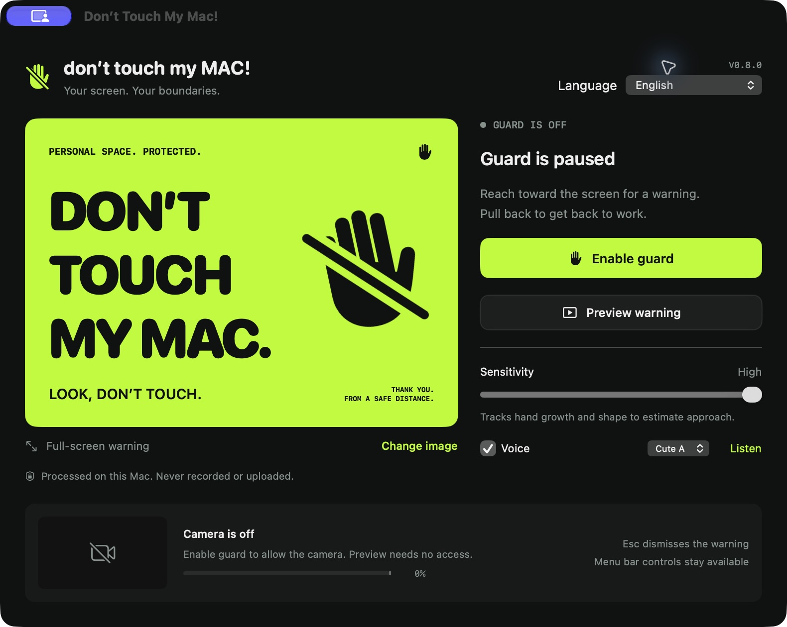

# Don’t Touch My Mac!

<p align="center">
  <a href="README.md">简体中文</a> | <b>English</b> | <a href="README_ja.md">日本語</a>
</p>

<p align="center">
  
  
  <a href="https://github.com/DDTer/dont-touch-my-mac/releases"></a>
  
  
  
</p>

A lightweight, native macOS screen-guard utility: monitors hand approach in real-time via the built-in FaceTime camera. The moment someone reaches out towards your screen, it triggers an eye-catching full-screen warning and plays a cute voice alert before their finger can leave smudges on your display. It smoothly dismisses itself once the hand retracts.

Say goodbye to oily fingerprints on your expensive Retina or external displays caused by colleagues "pointing and gesturing" at your screen!

---

## 🎬 Live Demo

<p align="center">
  
</p>

*Whenever a hand extends towards your screen, full-screen defensive alert & voice warning fire instantly; once the hand withdraws, it smoothly restores your workspace!*

---

## 📥 Download & Installation

No coding knowledge required — simply download the pre-packaged DMG image:

> 👉 **[Download Latest DontTouchMyMac.dmg](https://github.com/DDTer/dont-touch-my-mac/releases/latest/download/DontTouchMyMac.dmg)**  
> *(or view all historical releases on the [GitHub Releases Page](https://github.com/DDTer/dont-touch-my-mac/releases))*

### Quick Setup

1. Download and open `DontTouchMyMac.dmg`;
2. Drag `Don't Touch My Mac` into the `Applications` folder;
3. Launch the app and grant Camera permission (**camera video is processed exclusively in local volatile memory for skeletal geometry estimation; never recorded, never uploaded**);
4. Click **"Enable Guard"**, or hit the global shortcut **`⌥⌘G`** anytime to enter guard mode.

> [!TIP]
> **First-time launch error: "App is damaged or cannot verify developer"?**  
> As an indie open-source project without a paid commercial Apple Developer ID certificate, macOS 15 (Sequoia) Gatekeeper will intercept unsigned apps. You can bypass this in two ways:
> - **Geek way (Fastest via Terminal)**:
>   ```bash
>   xattr -cr /Applications/Don\'t\ Touch\ My\ Mac.app
>   ```
> - **System Settings way**: Go to Mac **"System Settings" -> "Privacy & Security"**, scroll to the bottom, and click **"Open Anyway"**.

---

## 📸 Screenshots

| Control Panel (English) | Fullscreen Warning Poster (Multi-Display Sync) |
| :---: | :---: |
|  |  |

*(Also supports [Simplified Chinese](docs/screenshots/zh-Hans.jpg) and [Japanese](docs/screenshots/ja.jpg))*

---

## ✨ Features

- ⚡️ **Dynamic Approach Detection**: Uses skeletal hand-topology scale tracking and multi-frame regression to detect reaching hands while ignoring normal typing or lateral hand gestures.
- 🎙 **9 Built-in Anime/Cute Voice Packs**: Replaces jarring alarm sirens with sweet voice prompts. Available in English, Japanese, and Chinese (with 3 distinct voice variants A/B/C per language — 9 in total). 100% offline WAV playback with zero latency and no cloud API required.
- 🎨 **4 Preset Themes + Custom Poster**: Includes Classic Warning, Cyberpunk, Anime, and Hacker Terminal themes. You can also upload any custom local image or meme as the warning poster.
- 🎚 **3 Sensitivity Levels**: Switch between High / Medium / Low sensitivity to match your desk depth and seating distance.
- 🖥 **Multi-Display Coverage**: Automatically expands across all connected active external monitors synchronously.
- ⌨️ **Global Shortcut `⌥⌘G`**: Quickly toggle guard mode on/off from anywhere without switching windows.
- 🛡 **Auto-Dismiss & Panic Escape**: Automatically restores your screen ~0.4s after the hand retracts; press `Esc` anytime for an emergency pause.
- 🔋 **MenuBar Resident & Low Battery Footprint**: Resides unobtrusively in the menu bar. Automatically pauses during system sleep/lock screen and smoothly resumes on wake.

---

## 🔒 Privacy First

- **Zero Network Access**: The app does not request or use network capabilities. No telemetry, analytics, or background tracking.
- **Purely In-Memory Processing**: Camera frames are passed strictly to Apple's native Vision framework in memory, keypoint coordinates are extracted, and frames are immediately discarded. **No photos or videos are ever saved to disk or transmitted anywhere**.
- **Offline Audio**: All voice resources are bundled offline compressed WAV files; no external TTS credentials needed.

---

## 🛠 Building from Source (Developers)

Built purely natively for macOS 14.0+ in Swift 5 with zero third-party dependencies.

```sh
# Clone repository
git clone https://github.com/DDTer/dont-touch-my-mac.git
cd dont-touch-my-mac

# Regenerate project and run full automated verification (50+ detection regression tests + localization checks)
./Scripts/build.sh
```

Build artifact: `build/Build/Products/Release/Don't Touch My Mac.app`.  
The project uses `project.yml` for XcodeGen. The generated `DontTouchMyMac.xcodeproj` is committed to the repo for instant opening in Xcode.

---

## 📐 Algorithm & Boundary Conditions

### 1. Monocular Heuristic Detection
The detector calculates physical scale/bone expansion ratios via monocular camera input:
- Combines persistent wrist/palm landmark tracking with metacarpal-to-phalange expansion ratios and trajectory consistency ($R^2$ fitting).
- Distinguishes upward reaching motions from typing knuckle flexing.
- Occlusion, rapid forward darts, strong backlighting, or low light may occasionally cause false positives or negatives.

### 2. Feel Free to Have Your AI Optimize It & Submit a PR!
Because detection uses pure heuristics and the architecture is modular and zero-dependency: **You are warmly welcome to feed this repository to your AI assistants (Cursor, Claude, Copilot, Antigravity, etc.) to refine detection logic, add new voice lines, or improve stability, and submit a PR!**

---

## 📄 License

Distributed under the [MIT License](LICENSE).
