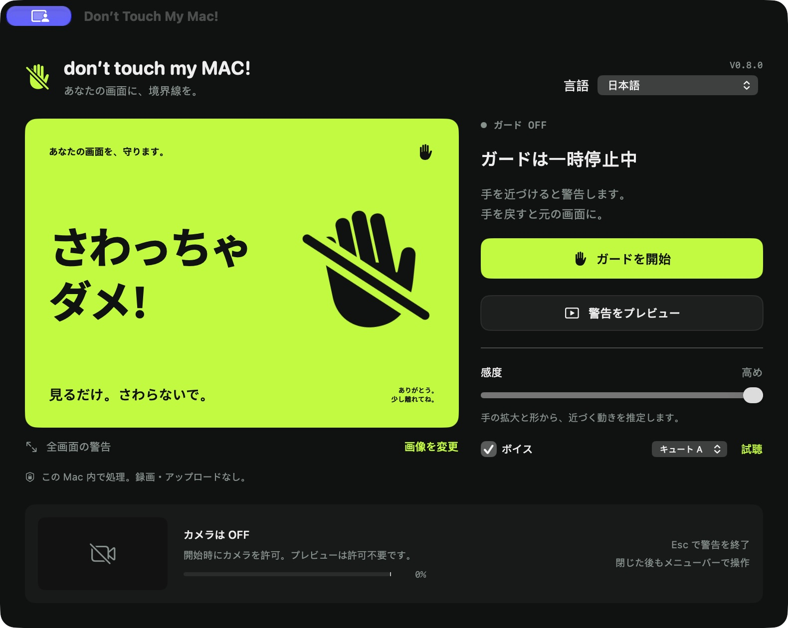

# Don’t Touch My Mac!

<p align="center">
  <a href="README.md">简体中文</a> | <a href="README_en.md">English</a> | <b>日本語</b>
</p>

<p align="center">
  
  
  
  
  
  
</p>

内蔵 FaceTime カメラを用いて画面に伸びてくる手をリアルタイムで検知し、ディスプレイに触れられる直前に全画面の警告画面とかわいいボイスアラートで防御する、軽量ネイティブ macOS 画面保護ツールです。手を引っ込めると自動的になめらかに元の画面へ復帰します。

同僚や友達があなたの大切な Retina ディスプレイや外部モニターを「指差して」油分や指紋をベッタリ残してしまうストレスから解放されましょう！

---

## 🎬 動作デモ

<p align="center">
  
</p>

*手が画面に近づいた瞬間、全画面警告と音声で即座に迎撃！手を引っ込めればすぐに自動復帰します！*

---

## 📥 インストール方法

コードの知識は不要です。ビルド済み DMG イメージをダウンロードしてすぐにご利用いただけます：

> 👉 **[最新版 DontTouchMyMac.dmg をダウンロード](https://github.com/DDTer/dont-touch-my-mac/releases/latest/download/DontTouchMyMac.dmg)**  
> *(過去のリリース一覧は [GitHub Releases ページ](https://github.com/DDTer/dont-touch-my-mac/releases) をご確認ください)*

### クイックセットアップ

1. `DontTouchMyMac.dmg` をダウンロードして開きます；
2. `Don't Touch My Mac` アイコンを `Applications`（アプリケーション）フォルダにドラッグ＆ドロップします；
3. アプリを起動し、カメラのアクセス権限を許可します（**映像は手の骨格座標をローカルメモリ上で計算するためだけに使用され、録画や外部送信は一切行われません**）；
4. **「画面保護を開始」** をクリックするか、グローバルショートカット **`⌥⌘G`** を押すと保護モードに入ります。

> [!TIP]
> **「開発元を検証できないため開けません / 壊れています」と表示される場合：**  
> 個人開発のオープンソース作品であり Apple の有料商用開発者証明書を使用していないため、macOS 15 (Sequoia) の Gatekeeper によりブロックされることがあります。以下のいずれかで即座に解除できます：
> - **ターミナルでの解除（推奨・最速）**：
>   ```bash
>   xattr -cr /Applications/Don\'t\ Touch\ My\ Mac.app
>   ```
> - **システム設定から解除**：Mac の **「システム設定」→「プライバシーとセキュリティ」** を開き、一番下までスクロールして **「このまま開く」** をクリックします。

---

## 📸 スクリーンショット

| 日本語コントロールパネル | 全画面警告ポスター（マルチディスプレイ同期） |
| :---: | :---: |
|  |  |

*( [簡体字中国語](docs/screenshots/zh-Hans.jpg) および [英語](docs/screenshots/en.jpg) もサポートしています)*

---

## ✨ 主な特徴

- ⚡️ **接近トレンドの動的判定**：手の骨格トポロジーと複数フレームの回帰分析により、画面に伸びる手を的確に検知。通常のタイピングや横方向の動作による誤検知を低減。
- 🎙 **中・日・英 9 種類の萌えボイス搭載**：不快なサイレンの代わりに、「ダメ！触らないで！」などのかわいいボイスで警告。各言語に 3 つの声質（A/B/C）を内蔵（計 9 種類）。ローカル WAV 再生のためクラウド API 不要＆完全オフライン・ゼロ遅延。
- 🎨 **4 種類のプリセットテーマ + カスタムポスター**：クラシック、サイバーパンク、アニメ風、ハッカーターミナルの 4 テーマを搭載。お好みのローカル画像やミームを警告画面に設定することも可能。
- 🎚 **3 段階の感度調整**：高 / 中 / 低の感度を切り替えることで、机の奥行きや着席位置に合わせた微調整が可能。
- 🖥 **マルチディスプレイ対応**：外部モニター接続時も、すべての稼働中ディスプレイに同期して全画面警告を展開。
- ⌨️ **グローバルショートカット `⌥⌘G`**：ウィンドウを切り替えることなく、どこからでも瞬時に保護モードのオン/オフが可能。
- 🛡 **自動復帰 & 緊急一時停止**：手を引っ込めてから約 0.4 秒で自動復元。警告中いつでも `Esc` キーで緊急一時停止が可能。
- 🔋 **メニューバー常駐 & 省電力**：Dock アイコンのないスマートなメニューバー常驻仕様。Mac のスリープや画面ロック時には自動で省電力待機し、復帰時にスムーズに再開。

---

## 🔒 プライバシーへの配慮

- **ネットワーク通信ゼロ**：本アプリはネットワーク通信権限を要求・使用しません。テレメトリやトラッキングコードも一切存在しません。
- **完全オンデバイス処理**：カメラ入力は Apple ネイティブの Vision フレームワークによりメモリ内でのみ骨格座標を抽出後、即座に破棄されます。**ディスクへの録画・保存や外部サーバーへの送信は一切行われません**。
- **オフライン音声**：すべての音声はローカルに圧縮 WAV としてバンドルされており、サードパーティの TTS API キーは不要です。

---

## 🛠 ソースコードからのビルド（開発者向け）

macOS 14.0+ 向け、Pure Swift 5 で実装。外部ライブラリ依存ゼロ（Zero Dependencies）。

```sh
# リポジトリのクローン
git clone https://github.com/DDTer/dont-touch-my-mac.git
cd dont-touch-my-mac

# プロジェクト再生成と自動テストの実行（50+ 件の検知ステートマシン回帰テスト & 多言語チェック）
./Scripts/build.sh
```

ビルド生成物：`build/Build/Products/Release/Don't Touch My Mac.app`  
XcodeGen の `project.yml` を使用しており、生成済みの `DontTouchMyMac.xcodeproj` もリポジトリに含まれているため、Xcode で直接開くことができます。

---

## 📐 アルゴリズムの特性とご注意

### 1. 単眼カメラによるヒューリスティック検知
単眼カメラのランドマーク相対スケール変化をベースにしています：
- 手首・手のひらの特徴点追跡と中手骨・指骨の拡大率、$R^2$ 軌跡一致度を総合判定。
- 急激な手の動き、逆光や極端な暗所、角度によって誤検知や未検知が発生する場合があります。

### 2. AI アシスタントを活用した PR を歓迎します！
検知ロジックはモジュール化されており外部依存がありません。**Cursor / Claude / Copilot / Antigravity などの AI コーディングツールにリポジトリを渡して、アルゴリズムの改善や新機能の提案、PR の送信を大歓迎しています！**

---

## 📄 ライセンス

本プロジェクトは [MIT License](LICENSE) のもとで公開されています。
